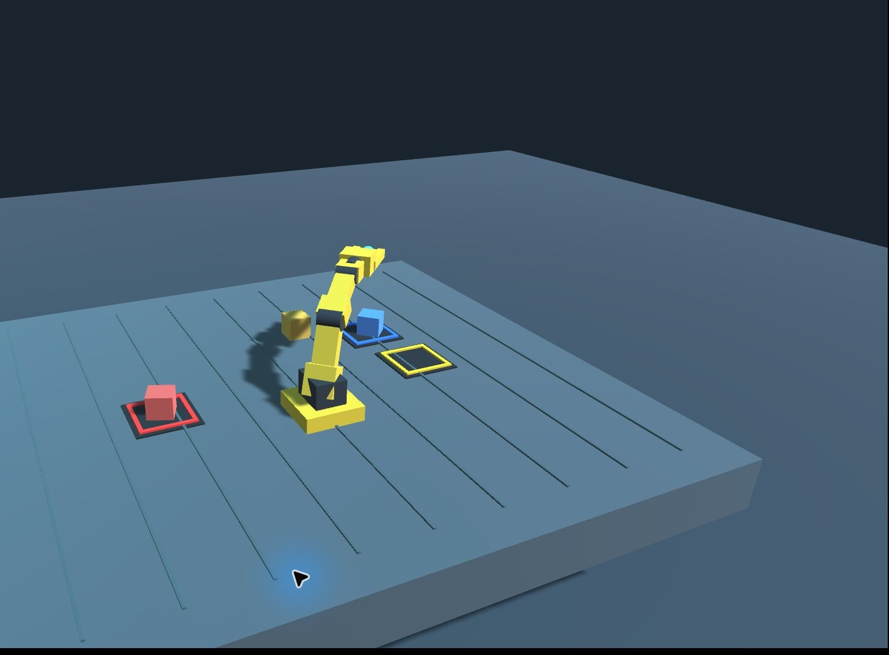

# MCP 加速视觉闭环：红蓝两色分拣

**日期：** 2026-11-02

**结果：** 红块与蓝块均通过画面确认放入匹配目标框

## 执行方式

- 每轮先调用 `observe_scene` 获取一张斜视截图，然后调用一次 `pick_place_from_pixels`，用截图中的像素点指定物体和目标。
- MCP 在单次动作调用中预检工作空间和逆运动学，执行接近、闭爪、抬升、搬运、松爪和撤离，再返回新截图。
- 两轮都只用斜视画面，没有切换俯视角。目标与结果都按截图判断；没有读取仿真状态或物体坐标接口。
- 第二轮经 MCP stdio 传输执行，回传的截图只包含 3D 视口，便于直接选像素与核验。

## 视觉结果

图中红块与蓝块位于同色框内，黄块留在工作台上。命令接受回执只表示仿真收到动作；是否抓取和放置成功以这张画面为准。

## 测试范围

本次验证 MCP 工具链与 Unity 仿真中的两次像素定位抓放，不验证真实硬件。仿真夹爪使用距离阈值附着物体，未建模接触力、夹持稳定性或碰撞自由路径；逆运动学预检不等同于完整碰撞规划。
